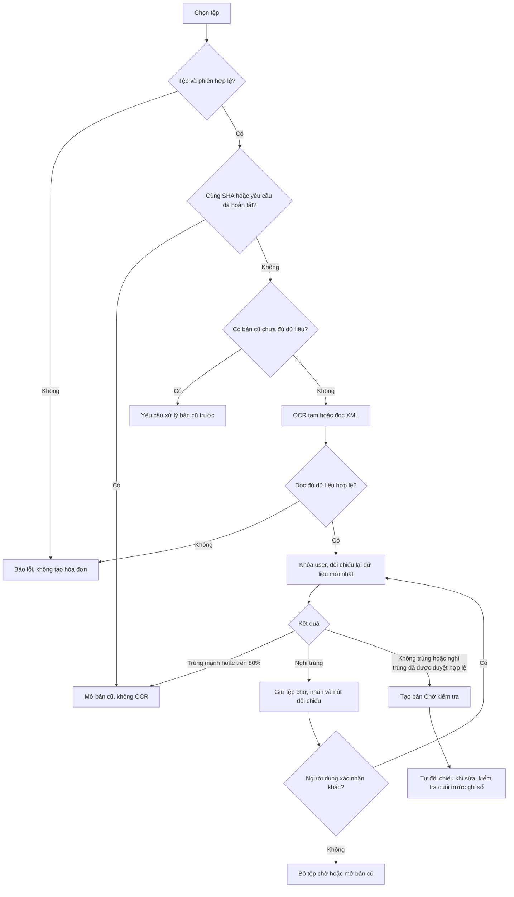

# Workflow hóa đơn: kiểm tra trước khi tạo và kiểm tra trước khi ghi sổ

Cập nhật mã nguồn: 27/10/2026. Phạm vi hoàn thiện: API tải lên dùng chung và hai màn hình web Hóa đơn AI/Sổ thu chi. Không cần migration cơ sở dữ liệu.

## 1. Kết quả thay đổi

Trước đây ảnh được tạo thành hóa đơn “Chưa quét” ngay khi tải lên. Hiện tại ảnh mới được kiểm tra SHA-256, tự OCR và đối chiếu trước khi thêm vào danh sách. Người dùng không cần bấm “Quét AI” lần đầu cho ảnh mới tải thành công.

“Chưa tạo bản mới” nghĩa là chưa có dòng mới trong bảng invoices, chưa lưu ảnh mới vào thư mục hóa đơn và chưa có giao dịch thu chi. Trong lúc kiểm tra, bytes và kết quả OCR nằm trong bộ nhớ xử lý yêu cầu; với trường hợp nghi trùng, trình duyệt giữ File và phiếu đối chiếu mã hóa. Đây không phải hàng đợi nền bền vững của giai đoạn tải lên.

## 2. Luồng người dùng thông thường

1. Người dùng chọn/kéo thả ảnh hoặc PDF một hóa đơn, hoặc chọn XML. Web hỗ trợ chọn nhiều tệp và xử lý tuần tự từng tệp.
2. Giao diện hiện **“Đang kiểm tra hóa đơn…”**. Tệp đang kiểm tra chưa xuất hiện thành hóa đơn mới trong danh sách chính.
3. Server kiểm tra định dạng, dung lượng, phiên đăng nhập, SHA-256 và yêu cầu lặp.
4. Nếu bytes đã có: trả về bản cũ, không gọi OCR. Web mở thông báo và có nút **“Mở hóa đơn đã có”**.
5. Nếu là tệp khác và lịch sử có đủ dữ liệu: ảnh/PDF tự được gửi qua dịch vụ OCR đang cấu hình; XML được đọc trực tiếp. Không giữ giao dịch SQL khi chờ OCR.
6. Server kiểm tra dữ liệu nhận diện, khóa thao tác theo người dùng rồi kiểm tra lại SHA và nội dung với các bản đã có.
7. Không thấy bằng chứng trùng/nghi trùng: lưu ảnh, thông tin và mặt hàng trong một giao dịch, tạo hóa đơn **“Chờ kiểm tra”**.
8. Người dùng kiểm tra, sửa thông tin hoặc mặt hàng; hệ thống tự đối chiếu lại. Chỉ khi người dùng bấm xác nhận ghi sổ mới đi vào luồng tạo khoản chi.

## 3. Cùng tệp và cùng hóa đơn chụp khác góc

**Đổi tên tệp nhưng giữ nguyên bytes:** SHA-256 giống nhau. Tên không tham gia quyết định trùng. Trả bản cũ dù nó đang Chưa quét, Đang xử lý, Chờ kiểm tra hoặc đã ghi sổ.

**Xoay/chụp lại, nghiêng, đổi ánh sáng hoặc nén ảnh:** bytes thường khác nên SHA khác. Server nhận diện nội dung trước khi tạo. Nếu đọc ra bằng chứng trùng mạnh hoặc điểm trên 80%, trả ID bản cũ và bỏ kết quả tạm; không tạo bản sao, không ghi đè thông tin bản cũ.

**Ảnh mờ/lóa/cắt mất nội dung:** nếu thiếu người bán, ngày, tổng tiền dương và số hóa đơn hoặc giỏ hàng đủ chi tiết, trả lỗi yêu cầu ảnh rõ, đầy đủ hơn. Không xem “không đọc được” là “không trùng”. OCR vẫn có thể đọc sai nhưng đủ trường; trường hợp này có giới hạn được nêu ở mục 10.

## 4. Quyết định theo mức tương đồng tại lúc tải lên

- **Bằng chứng EXACT** theo quy tắc hiện có, hoặc **điểm >80**: trả bản cũ, thông báo trùng, không có nút ép tạo bản mới trong luồng tải lên.
- **50–80, gồm đúng 80**, hoặc bằng chứng nghi trùng hiện có: trả 409 `UPLOAD_REVIEW_REQUIRED`. Web hiện nhãn **Nghi trùng**, nút mở bản cũ và liên kết xem tệp mới ở tab riêng để đối chiếu. Tệp chưa vào danh sách chính.
- Nếu đúng cùng hóa đơn: người dùng mở bản cũ và bấm **Bỏ tệp chờ**. Không cần tạo rồi xóa một bản sao.
- Nếu là hóa đơn khác: bấm **“Đã đối chiếu: đây là hóa đơn khác”**. Web gửi lại tệp cùng phiếu mã hóa; server dùng lại OCR, không quét thêm chỉ vì xác nhận.
- Khi xác nhận, server đối chiếu lại. Nếu vừa xuất hiện bản trùng mạnh/trên 80, trả bản đó. Nếu bằng chứng nghi trùng đã đổi, yêu cầu đối chiếu lại. Chỉ tạo mới khi quyết định còn phù hợp với dữ liệu mới nhất.
- **Dưới 50 và không có quy tắc trùng khác:** tạo bản Chờ kiểm tra khi dữ liệu đủ điều kiện. Điểm thấp không phải chứng minh tuyệt đối rằng hai ảnh khác hóa đơn.

Phiếu đối chiếu có hiệu lực 30 phút, ràng buộc người dùng, phiên, nội dung tệp và nguồn tải. Phiếu giả, hết hạn, khác tệp hoặc khác người dùng bị từ chối. Khi đó cần tải lại để kiểm tra. Không lưu phiếu hoặc ảnh vào sessionStorage của web.

## 5. Hóa đơn cũ chưa quét, đang xử lý hoặc OCR lỗi

Các bản cũ được tạo trước thay đổi này có thể chưa có dữ liệu để so sánh.

- Tải đúng bytes của bản cũ: vẫn mở bản cũ ngay, không gọi OCR.
- Tải bytes khác trong khi còn bản đang Chưa quét/Đang xử lý/Thất bại hoặc thiếu người bán/ngày/tổng tiền: API trả `UPLOAD_HISTORY_INCOMPLETE`, kèm tối đa 20 bản cần xử lý. Web có nút **Mở bản cần kiểm tra**.
- Người dùng quét/hoàn tất bản cũ, chờ tác vụ đang chạy, hoặc xử lý bản không còn cần giữ theo chức năng hiện có; rồi thử lại tệp mới.
- Đây là quy tắc thận trọng áp dụng trong phạm vi tài khoản: kể cả ảnh mới thực sự khác cũng có thể phải chờ bản cũ. Hệ thống không tự đoán rằng ảnh mới khác bản chưa đọc được, và không tự quét toàn bộ lịch sử.

## 6. Bản đã ghi sổ, Thùng rác và tệp bị mất

- Bản đã ghi sổ được nhận diện trùng: mở bản đã ghi sổ; không tạo giao dịch hay trừ ví lần nữa.
- Bản trong Thùng rác được giữ 30 ngày, gồm ảnh và thông tin. Tải cùng SHA hoặc phát hiện trùng nội dung trả bản cũ, không tự khôi phục; áp dụng cả bản chưa ghi sổ.
- Trước hạn người dùng chủ động khôi phục. Hết hạn API không cho khôi phục; worker xóa vĩnh viễn hóa đơn và tệp, giữ khoản chi nhưng gỡ liên kết hóa đơn.
- Sau khi xóa vĩnh viễn, dữ liệu chống trùng của bản đó không còn. Xem [chính sách Thùng rác](thung-rac-hoa-don.md) về thời hạn, worker và dữ liệu cũ.
- Bản cũ được khôi phục nhưng thiếu ảnh: tải đúng bytes có thể bổ sung lại tệp. Một ảnh chụp khác dù trùng dữ liệu không tự thay ảnh/hash của bản cũ.
- Hai tài khoản độc lập không được xem hoặc đối chiếu hóa đơn của nhau. Các ví trong cùng tài khoản dùng chung phạm vi chống trùng.

## 7. Lỗi và thao tác gián đoạn

- **Sai định dạng/nội dung giả đuôi:** từ chối trước OCR. Nhận JPG/JPEG, PNG, WEBP, PDF, XML; tối đa 10 MB/tệp. HEIC cần chuyển đổi trước.
- **XML không hợp lệ hoặc chứa cấu trúc cấm:** từ chối; XML hợp lệ vẫn phải qua kiểm tra dữ liệu và chống trùng.
- **OCR trả dữ liệu không hợp lệ:** 422 `UPLOAD_INVALID_OCR`; chưa lưu tệp hay hóa đơn.
- **OCR bận, lỗi mạng, hết hạn mức hoặc quá thời gian:** 503 `UPLOAD_OCR_UNAVAILABLE`; chưa tạo bản mới. Thời gian chờ OCR được chặn ở 90 giây. Thông báo không kết luận mọi lỗi OCR đều do quota.
- **Mạng mất sau khi server đã ghi thành công:** client giữ khóa yêu cầu để thử lại. Server tìm kết quả đã có, không tạo thêm hóa đơn. Nếu gửi yêu cầu hoàn toàn mới, SHA/nội dung vẫn được kiểm tra.
- **Hết phiên/đăng xuất trong lúc chờ:** server kiểm tra phiên lại khi lấy khóa trước khi ghi; không dùng phiên đã bị thu hồi để tạo bản mới.
- **Đóng trang khi tệp đang chờ đối chiếu:** File/phiếu web mất khi tải lại trang; người dùng phải chọn lại. Việc đóng trang không bảo đảm hủy một yêu cầu đã đến server; kiểm tra danh sách hoặc thử lại an toàn.
- **Bỏ tệp chờ:** chỉ bỏ tệp và phiếu ở trình duyệt; không xóa bản cũ hay khoản chi.
- **Một tệp lỗi trong lô web:** ghi nhận lỗi riêng, tiếp tục tệp kế tiếp; các tệp nghi trùng còn chờ được giữ khi thử lại tệp khác.
- **Lỗi DB trước commit:** rollback và dọn tệp chưa ghi nhận. Deadlock được thử lại tối đa 3 lần mà không OCR lại. Nếu kết quả commit chưa xác định, giữ tệp để tránh xóa nhầm ảnh đã ghi; client thử lại cùng khóa. Cần dọn tệp mồ côi bằng vận hành nếu commit thực tế không thành công.

## 8. Nhiều lần tải đồng thời

Hai ảnh khác nhau có thể cùng đang OCR trong bộ nhớ. Không có bản mới nào được tạo chỉ vì OCR bắt đầu. Khi mỗi kết quả quay về, server khóa theo user và đối chiếu lại trước khi ghi. Yêu cầu sau nhìn thấy bản mà yêu cầu trước vừa hoàn tất; nếu đủ bằng chứng trùng thì trả bản đó.

Khóa này bảo vệ bước quyết định/lưu; nó không loại bỏ chi phí OCR của hai yêu cầu đã cùng bắt đầu. Nó cũng không làm tăng quota Gemini. Phiên bản này không bổ sung hàng đợi OCR dùng chung toàn project cho giai đoạn tải lên và chưa được load-test với 100–200 người cùng lúc. Vì vậy không báo cáo rằng hệ thống có thể xử lý ngay tất cả yêu cầu đồng thời.

## 9. Giai đoạn 2 và ghi sổ

Sau khi tạo được bản Chờ kiểm tra, người dùng kiểm tra dữ liệu và sửa nếu cần. Web tự đối chiếu sau khi ngừng sửa khoảng 600 ms và kiểm tra lại mỗi 10 giây khi biểu mẫu có thể chỉnh sửa. Đối chiếu này dùng dữ liệu trong DB, không gọi Gemini.

Trên 80% mở thông báo; 50–80% hiện nhãn nghi trùng và nút đối chiếu. Dữ liệu thiếu được hướng dẫn bổ sung/quét. Nút **Quét lại** là yêu cầu OCR mới khi người dùng thực sự cần nhận diện lại, có thể tiêu thụ thêm quota.

Trước ghi sổ, server kiểm tra lại dữ liệu/phiên bản và bằng chứng trùng. Quy tắc EXACT chặn ghi trùng; SUSPECTED yêu cầu xác nhận đối chiếu theo hợp đồng hiện có. Điểm thông báo cao ở giai đoạn 2 không tự gộp/xóa bản ghi. Chỉ luồng xác nhận ghi sổ mới tạo khoản chi; tải lên và đối chiếu không tự thay số dư.

## 10. Ý nghĩa 80% và giới hạn cần nói rõ với hội đồng

80% là **điểm tương đồng dữ liệu theo quy tắc**, không phải xác suất AI đúng 80% hay tỷ lệ pixel giống nhau. Xem công thức trong [tài liệu đối chiếu tự động](kiem-tra-trung-tu-dong.md).

Hệ thống đã chuyển kiểm tra nội dung lên trước bước tạo hóa đơn. Khi nhận diện được cùng nội dung với đủ bằng chứng, ảnh chụp khác góc không tạo thêm bản. Tuy nhiên, không thể cam kết nhận ra 100% mọi ảnh mờ, mất chữ, bị sửa nội dung hoặc OCR đọc sai. Ngày và số phiếu cùng bị đọc sai có thể làm bỏ lỡ ứng viên; hai hóa đơn thật sự khác nhưng dữ liệu giống cao có thể bị giữ lại. Người dùng cần kiểm tra bản được chỉ tới; không có thao tác ép tạo bản trên 80 trong cổng tải lên.

Phạm vi tệp là **một hóa đơn trên mỗi tệp**. Chưa có bước tách nhiều hóa đơn trong một ảnh/PDF. Không dùng trường hợp này để khẳng định chống trùng đầy đủ.

Các bản trùng đã tồn tại trước thay đổi không được tự động dọn/gộp. Cơ chế mới kiểm soát lần tải mới.

API chung bảo vệ cả client cũ. Giao diện ticket/đối chiếu trước tải lên đã làm trên web. Flutter hiện có hàng đợi cục bộ và API sẽ từ chối trường hợp nghi trùng, nhưng màn hình xác nhận ticket trước khi tạo ngay trên mobile chưa được bổ sung; không gọi đây là giao diện mobile đã hoàn thiện tương đương web.

## 11. Kiểm chứng và triển khai

- 33 kiểm thử Python và 12 subtest đã qua: quy tắc trùng, dữ liệu thiếu/sai, phiếu hết hạn, không thể bỏ qua chỉ bằng accept_distinct.
- Kiểm thử HTTP với SQL Server thật, OCR giả lập: tạo bản Chờ kiểm tra và mặt hàng; SHA/đổi tên/retry không gọi OCR; ảnh khác trả bản cũ; nghi trùng chưa tạo; ràng buộc phiếu theo tệp/user; dữ liệu cũ thay đổi phải duyệt lại; xác nhận không OCR thêm; ảnh không đủ dữ liệu và provider lỗi không lưu; bản cũ chưa quét chặn; XML; giả lập một bản khác được ghi trong khi yêu cầu đang chờ OCR.
- Dữ liệu thử SQL nằm trong giao dịch ngoài và đã rollback; ảnh giả lưu trong thư mục tạm. Không gửi 1.jpg–4.jpg hay ảnh cá nhân nào tới Gemini trong lượt kiểm thử này.
- Kiểm thử trình duyệt bằng API giả lập: trạng thái đang kiểm tra, nghi trùng, gửi ticket, popup mở bản cũ, liên kết bản cần quét, lỗi OCR. Đây không phải đánh giá độ chính xác Gemini trên bộ ảnh thực.
- TypeScript và ESLint các tệp web sửa được kiểm tra. Kiểm thử giai đoạn 2 được giữ lại.
- Next proxy và timeout upload mobile đặt 120 giây để có dư thời gian cho OCR tối đa 90 giây. Hạ tầng reverse proxy/CDN ngoài repository cần cho phép thời gian tương ứng; chưa xác minh triển khai công khai trong lượt này.
- Cần chạy backend/web từ mã mới (hoặc build/deploy theo quy trình hiện hành). Không cần đổi schema; dùng khóa mã hóa đã cấu hình sẵn. Báo cáo này xác nhận mã nguồn và kiểm thử, không xác nhận rằng mọi máy chủ production đã nhận phiên bản mới.

## 12. Cách trình bày ngắn với hội đồng

“Chúng tôi kiểm tra trùng theo hai thời điểm. Trước khi tạo hóa đơn, hệ thống đối chiếu SHA-256, sau đó nhận diện nội dung trong vùng tạm nếu là ảnh khác. Hóa đơn trùng được dẫn về bản có sẵn; trường hợp nghi trùng cần người dùng đối chiếu; thiếu dữ liệu hoặc OCR lỗi thì chưa tạo bản mới. Sau khi có bản chờ kiểm tra, hệ thống tiếp tục đối chiếu khi sửa và kiểm tra lại trước ghi sổ. Cách này giảm bản sao và ghi nhận chi tiêu lặp; chất lượng nhận diện vẫn phụ thuộc ảnh và OCR, nên chúng tôi không tuyên bố nhận ra tuyệt đối mọi biến thể ảnh.”
